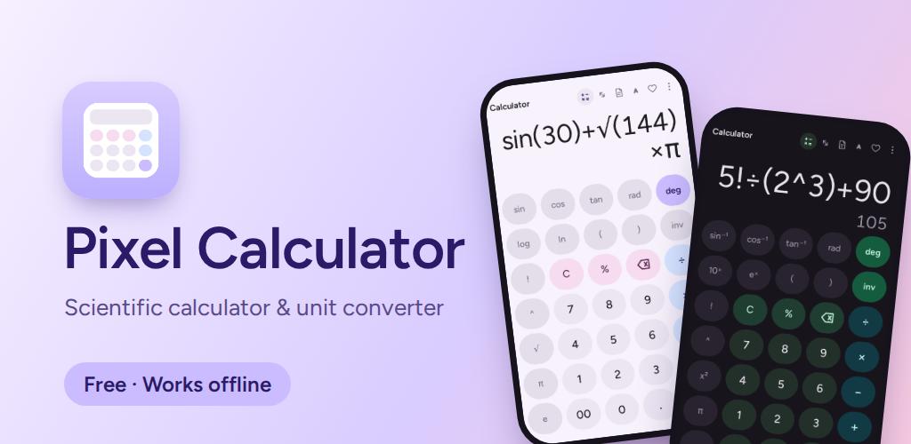
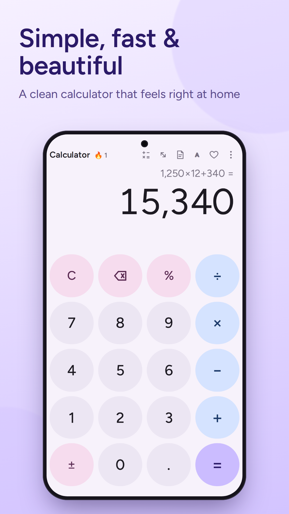
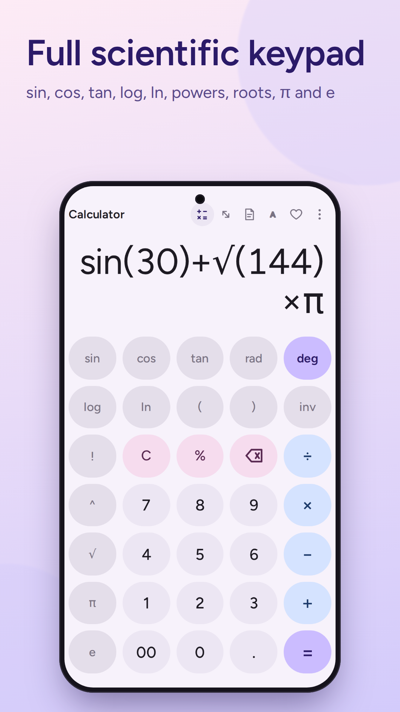
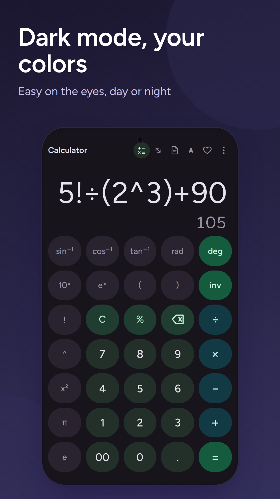
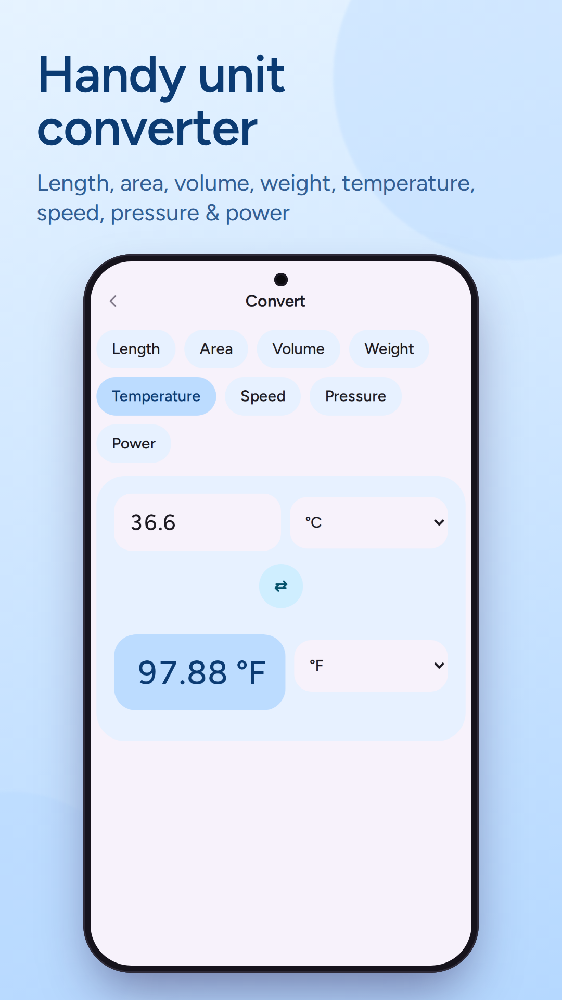
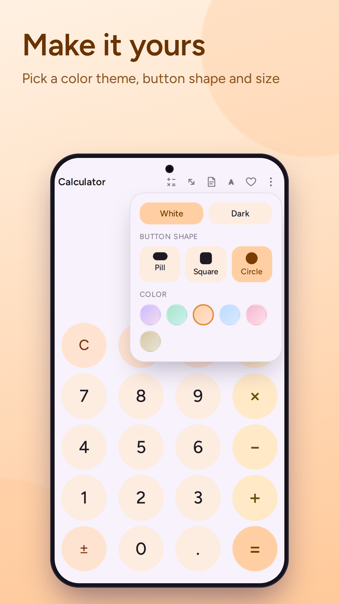
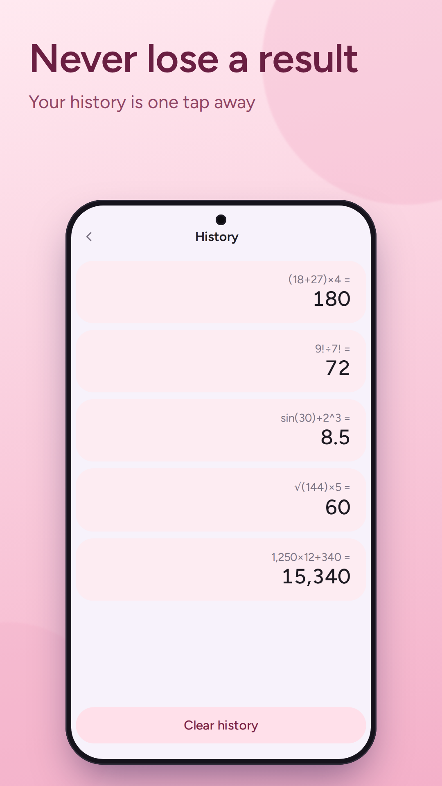
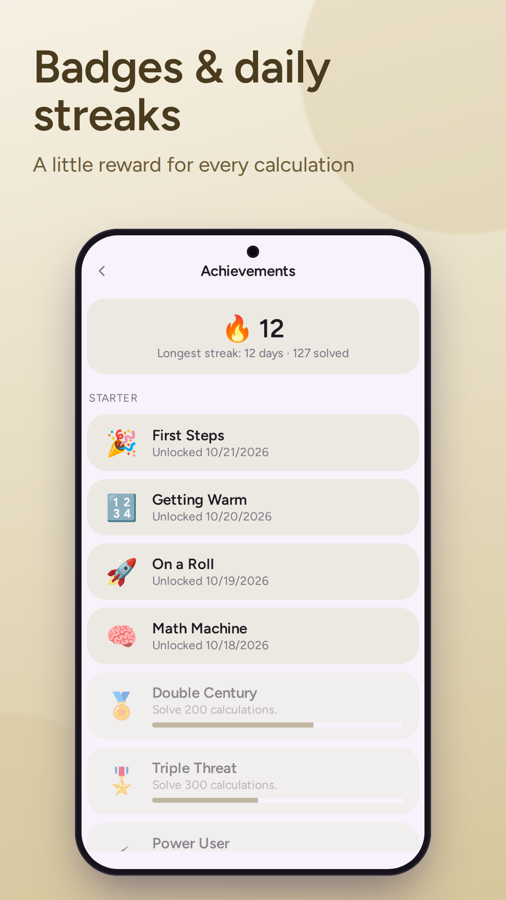
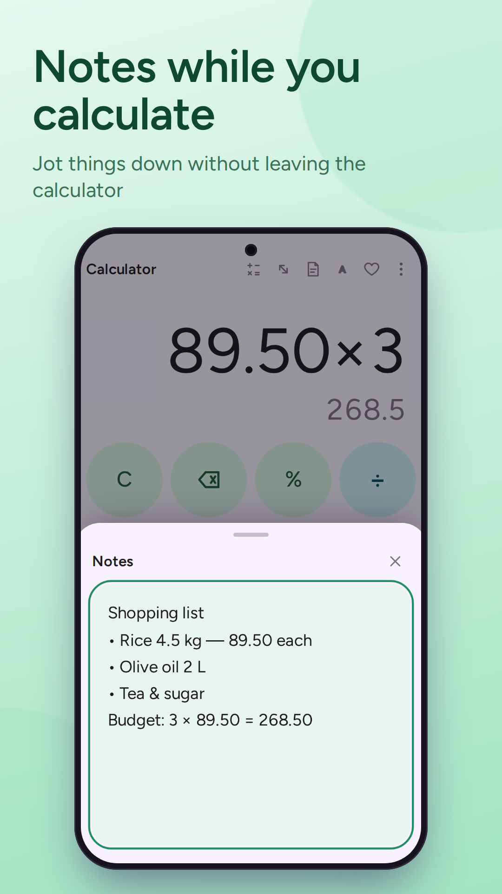

# 🧮 Pixel Calculator

A beautifully designed, highly customizable calculator available across multiple platforms. Whether you need a standard calculator, advanced scientific functions, unit conversions, or a quick notepad, Pixel Calculator delivers a premium and personalized experience.

## 🌐 Try it Online
You can use Pixel Calculator right now on your web browser without downloading anything:
👉 **[Launch Pixel Calculator Web App](https://pixelcalculator-me.netlify.app)**

## 📱 Download the App

Pixel Calculator is available across multiple app ecosystems. Choose your preferred platform:

| Platform | Link | Description |
| :--- | :--- | :--- |
| **Amazon Appstore** | [📥 Download Here](https://www.amazon.com/dp/B0HP81YKXX?path=%2Fdp%2FB0HP81YKXX&useRedirectOnSuccess=1&ref_=mas_buy_sign_in) | Available for Android devices via the Amazon Appstore. |
| **itch.io** | [🎮 Play/Download Here](https://haroon0.itch.io/pixel-calculator) | Download or play directly from the indie game platform. |
| **Orion Store** | [🚀 Get it Here](https://rookieenough.github.io/Orion-Data/app/?id=pixel-calculator) | Available on the Orion alternative app store. |

---

## ✨ Features

*   **Deep Customization:** Switch between **White** and **Dark** themes. Choose your button shapes (**Pill, Square, or Circle**) and pick from a variety of vibrant accent colors.
*   **Advanced Scientific Mode:** Access trigonometry (sin, cos, tan), logarithms (log, ln), square roots, powers, factorials, and constants like π and e. Supports both Degree and Radian modes.
*   **Integrated Unit Converter:** Convert between Length, Area, Volume, Weight, Temperature, Speed, Pressure, and Power instantly.
*   **Calculation History:** Never lose a number again. View your past equations with a simple tap.
*   **Built-in Notepad:** Jot down quick numbers or multi-step equations in the slide-up notes panel. It saves automatically.
*   **Clean UI:** Large, easy-to-read numbers and responsive buttons designed for an optimal user experience.

---
*If you find this project useful, please consider giving it a ⭐️!*
